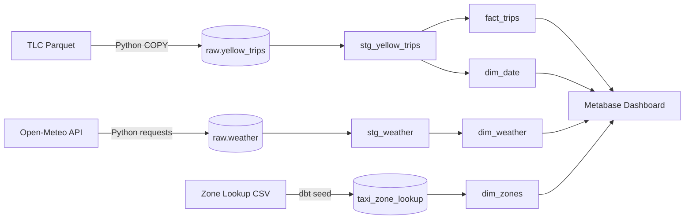
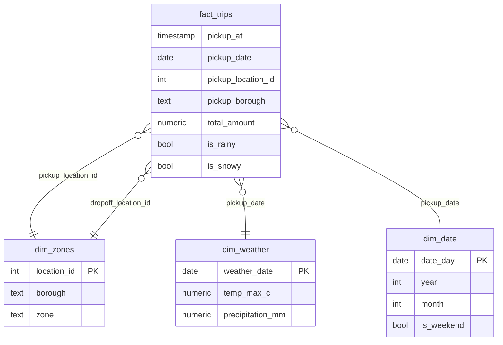

# NYC Taxi Trips ELT Pipeline

End-to-end data pipeline that ingests NYC TLC taxi trip data + NYC weather, builds a tested star schema with dbt, and serves it for analytics.

## Architecture



## Star Schema



## Tech Stack

- **Ingestion:** Python 3.11, pandas, pyarrow, requests, psycopg2
- **Storage:** PostgreSQL 16 (Docker)
- **Transform:** dbt-core 1.8.9 + dbt-postgres 1.8.2
- **BI:** Metabase (Docker)

## Data Layers

- **raw:** exact source shape, no transforms
- **staging:** renamed, cast, filtered to source month (`views`)
- **marts:** star schema — `fact_trips` + 3 dims (`tables`)

## Key Features

- **Idempotent ingestion** — re-running any month deletes and reloads
- **Fast bulk load** — PostgreSQL `COPY` for 3M rows (~80s vs 31min)
- **Data quality** — 11 dbt tests (`not_null`, `unique`, `accepted_values`)
- **Date hygiene** — filters bad dates (2002/2090 rows in TLC data)
- **Weather enrichment** — daily NYC weather joined to trips

## How to Run

```bash
docker compose up -d
py -3.11 -m venv .venv
.venv\Scripts\activate
pip install -r requirements.txt
pip install dbt-core==1.8.9 dbt-postgres==1.8.2

python -m ingestion.load_trips --year 2024 --month 1
python -m ingestion.load_weather --year 2024 --month 1

dbt seed
dbt build --select +fact_trips
```

## Results (2024-01)

| Metric | Value |
|---|---|
| Trips | 2,964,606 |
| Weather days | 31 |
| Zones | 265 |
| dbt tests | 17 |
| Ingestion | ~80s (COPY) |
| Full build | ~34s |

## Roadmap

- [ ] Airflow DAG for scheduled runs
- [ ] Kafka streaming
- [ ] PySpark 12-month backfill
- [ ] GitHub Actions CI
- [ ] Cloud (S3 + BigQuery)
## Dashboard


